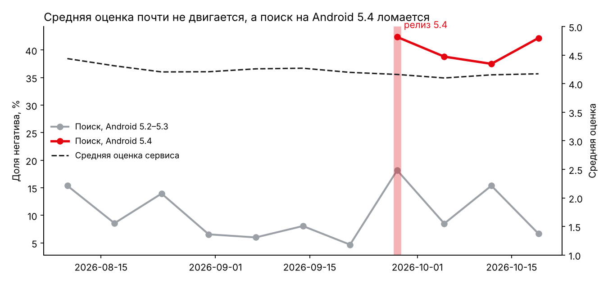
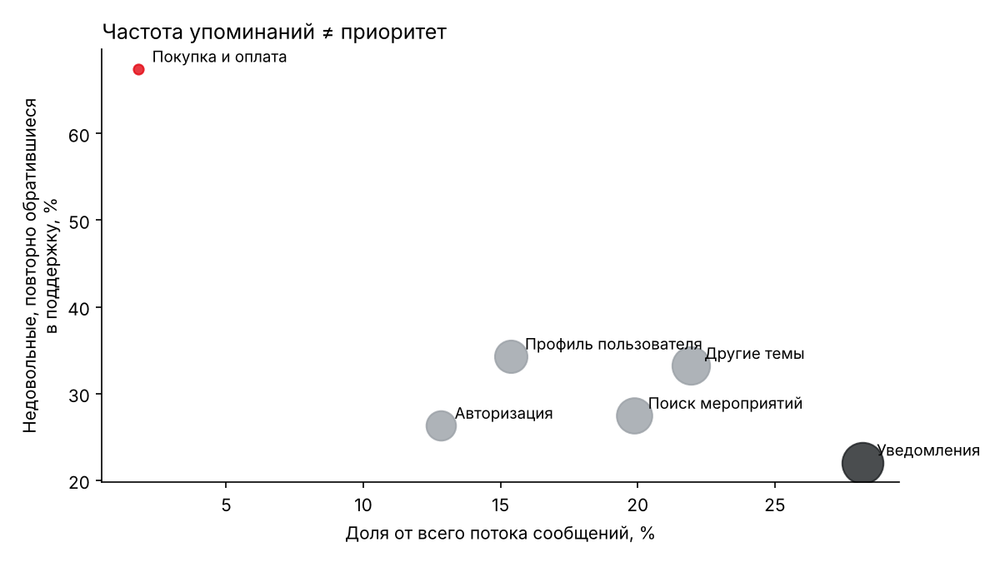
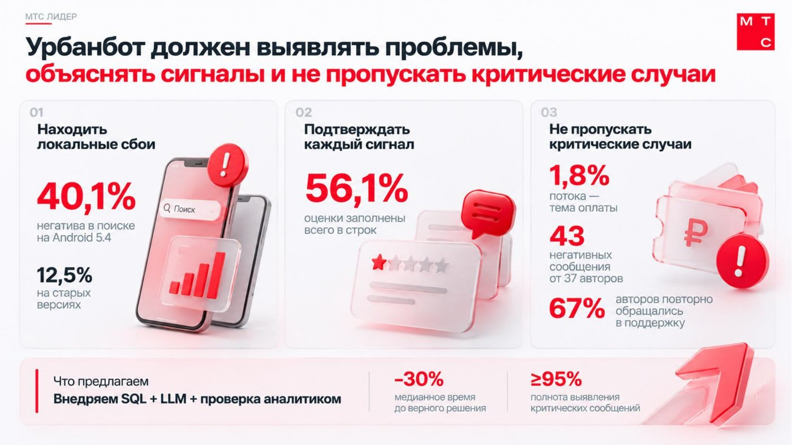
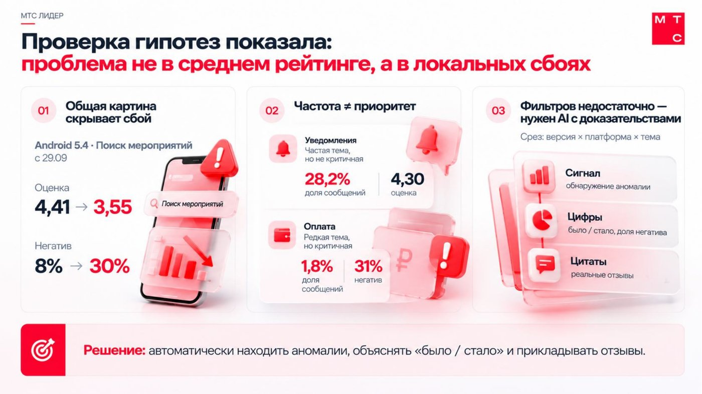
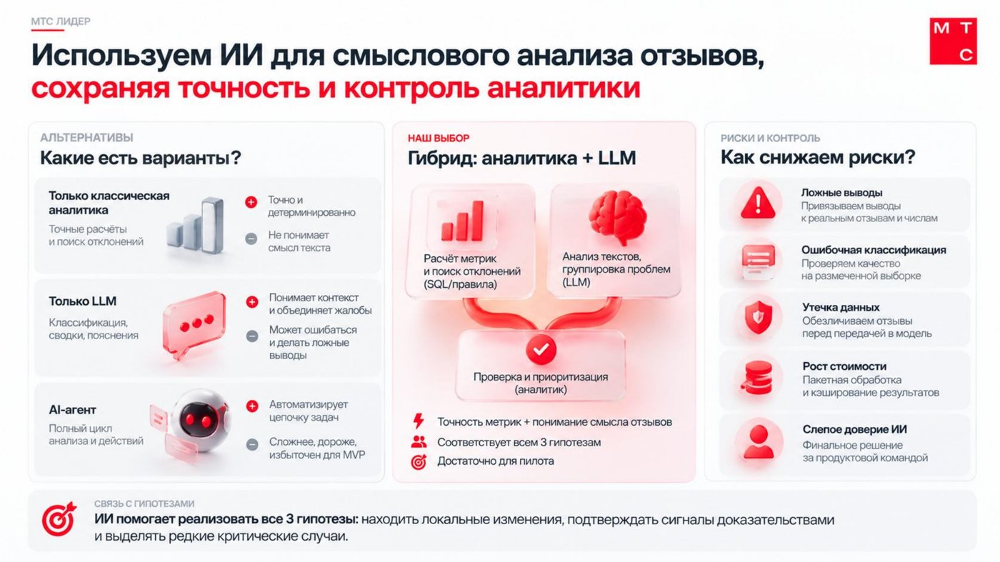

# Урбанбот: детектор сигналов в обратной связи пользователей

Кейс с финального этапа отбора в **МТС Лидер 2026** (трек Product Manager, AI), центр оценки 27.10.2026.
Командный кейс на 90 минут, команда №8. После центра оценки я переоформил решение в воспроизводимый проект: код анализа, детектор сигналов и формулу приоритета.

> Компания «Билетти» и все данные в кейсе вымышленные: это учебный материал организаторов.
> Исходная выгрузка в репозиторий не входит (см. [`data/README.md`](data/README.md)).

---

## Задача

«Билетти» — городской сервис афиши и билетов (iOS, Android, веб). Каждый месяц приходит около 3 300 отзывов из трёх каналов: форма в приложении, магазины приложений и поддержка. Продакты и аналитики разбирают их вручную: после каждого релиза делают несколько выгрузок, чтобы понять, изменилось ли что-то.

Команда начала делать внутренний инструмент «Урбанбот». По легенде кейса команда «потеряла память» о проекте, и восстановить его нужно было по архиву: письма заказчика, интервью, гипотезы, результаты пилота, черновой прототип и полная выгрузка.

**Пользователь:** продакт-менеджеры и продуктовые аналитики.
**Что им нужно (из письма заказчика):** понять, *появилось ли изменение, чего оно касается и почему его стоит считать важным*.

**Проблема первой версии:** её построили на пилоте из 500 сообщений, и она показывала общую картину: средняя оценка 4,2, 78% позитива, «существенных проблем не обнаружено». Она отвечала на вопрос «как дела в среднем», а пользователям нужно было «что сломалось».

### Материалы кейса

Фотографии раздаточных материалов: легенда, задание, письма заказчика и коллег, заметки по интервью, гипотезы, результаты пилота, черновик идей.

| | | |
|---|---|---|
| [Легенда](docs/case/01_legend.jpg) | [Что известно](docs/case/02_context.jpg) | [Задание 1–2](docs/case/03_task_1-2.jpg) |
| [Задание 3–4](docs/case/04_task_3-4.jpg) | [Что сдать через 90 минут](docs/case/06_deliverables.jpg) | [Письмо 1: запрос заказчика](docs/case/07_letter1_request.jpg) |
| [Письмо 2: вопросы команды](docs/case/08_letter2_questions.jpg) | [Письмо 3: ответ заказчика](docs/case/10_letter3_answer.jpg) | [Письмо 4: пилот](docs/case/11_letter4_pilot.jpg) |
| [Письмо 5: полная выгрузка](docs/case/05_letter5_full_data.jpg) | [Письмо 6: маркетинг](docs/case/12_letter6_marketing.jpg) | [Интервью 1–2](docs/case/13_interviews_1-2.jpg) |
| [Интервью 3–5](docs/case/14_interviews_3-5.jpg) | [Гипотезы команды](docs/case/15_team_hypotheses.jpg) | [Результаты пилота](docs/case/16_pilot_results_1.jpg) · [стр. 2](docs/case/17_pilot_results_2.jpg) |
| [Черновик идей](docs/case/18_draft_ideas.jpg) | | |

**Где были ловушки.** Почти каждый документ архива был либо подсказкой, либо ловушкой:
- вывод пилота «уведомления — главная зона роста» (частая тема ≠ проблема);
- «проблем не обнаружено» (средняя скрывает локальный сбой);
- письмо маркетинга (расползание задачи на другого пользователя);
- черновик идей с облаком слов и прогнозом оттока (фичи без основания).

Подсказки: письмо 3 с готовым определением продукта, интервью 4 о редких, но критичных случаях, письмо 5 с чек-листом качества данных.

## Данные

7 800 сообщений от 3 548 авторов за 15.08–24.10.2026.

| Проверка качества | Результат | Что делаем |
|---|---|---|
| Заполненность оценки | **56,1%** строк; в поддержке пусто у 92% | Средняя оценка не может быть главным показателем |
| Повторные авторы | 168 человек с 5+ сообщениями | Считаем уникальных авторов, а не сообщения |
| Версия приложения | Нет у 1 840 строк (веб, так и должно быть) | Веб — отдельный срез |
| Персональные данные | Имя, email, телефон | Удаляем при загрузке, маскируем в текстах |
| Репрезентативность пилота | Доля оплаты в пилоте 8%, в полном массиве **1,8%** | Выводы пилота перепроверяем |

## Что показали данные

### 1. Средняя оценка скрыла поломку
После выхода Android 5.4 (28.09) негатив в поиске на этой версии — **40,1%** (105 из 262) против **9,9%** в той же теме на остальных срезах. Разница в 4 раза, z = 9,3. Пожаловались 80 уникальных пользователей.
Поиск на Android в целом: негатив вырос с **7,9% до 29,6%**, оценка упала с **4,42 до 3,56**. При этом средняя оценка всего сервиса почти не изменилась.



### 2. Частота упоминаний не равна приоритету
| Тема | Доля потока | Негатив | Недовольные, повторно обратившиеся в поддержку | Оценка |
|---|---|---|---|---|
| Уведомления | 28,2% | 15,0% | 22,1% | 4,30 |
| Покупка и оплата | **1,8%** | **30,7%** | **67,4%** | **3,08** |

Вывод пилота «уведомления — главная зона роста» не подтвердился: о них пишут чаще всего, но в основном хвалят. Об оплате пишут редко, но это самый болезненный сценарий: «оплачено, а доступа нет», «заказ исчез из истории».



### 3. Одних фильтров мало
Сбой видно только на пересечении **тема × платформа × версия** и только при сравнении с контролем за тот же период. Второй найденный сигнал — уведомления на вебе: 23,4% негатива против 13,2%.

## Проверка гипотез команды

| Исходная гипотеза | Вердикт | Почему |
|---|---|---|
| Первый экран — общая картина | **Меняем** | Общая картина скрыла сбой Android 5.4 |
| Приоритет = число упоминаний | **Отвергаем** | Оплата: 1,8% потока, но 67% недовольных снова идут в поддержку |
| Достаточно фильтров по периоду, платформе, версии | **Частично** | Нужны сравнение с контролем и сквозной сценарий |
| Короткий вывод нейросети | **Сохраняем с условием** | Только с цифрами и цитатами (интервью: «захочу проверить, почему ИИ решил, что это важно») |

## Решение

Урбанбот из дашборда средних цифр превращается в **детектор изменений**:

1. **Первый экран — лента сигналов**, отсортированная по приоритету, а не по числу сообщений.
2. **Сравнение срезов с контролем** за тот же период (`detect_signals`).
3. **Прозрачная формула приоритета** (0–100): отклонение от контроля 40, тяжесть (повторные обращения в поддержку) 30, число авторов 20, значимость 10. Веса стартовые, их калибруют на пилоте.
4. **Отдельная очередь критичных случаев** (оплата, доступ к билету) с минимальным приоритетом: редкий случай не опускается вниз.
5. **Карточка доказательств:** числитель и знаменатель, авторы, контроль, исходные цитаты без персданных.

**От чего отказались** (из черновика идей): облако слов — по нему нельзя принять решение; прогноз оттока — нет данных об оттоке; анализ конкурентов — вне задачи; PDF-выгрузка — не боль пользователя.
**Запрос маркетинга** на еженедельную подборку тем — в бэклог как побочный отчёт. Это другой пользователь, а ядро не должно снова превратиться в «общую картину».

### Прототип

Командный HTML-прототип: [`docs/prototype/index.html`](docs/prototype/index.html). Открывается в браузере, работает без сервера.
Первый экран — сигналы, отсортированные по приоритету. Работают фильтры по платформе, версии, источнику, сегменту и сценарию. Есть сквозной сценарий «доступ к билету» поверх тем. Контактные данные из текстов удалены. ИИ-сценарии в прототипе демонстрационные, модель не подключена, и это подписано в интерфейсе.

## Презентация

Полная версия: [`docs/presentation/urbanbot_pitch.pdf`](docs/presentation/urbanbot_pitch.pdf).





## Роль ИИ

| Вариант | Плюсы | Минусы |
|---|---|---|
| Только аналитика (SQL, правила) | Точно, воспроизводимо | Не понимает смысл текста |
| Только LLM | Понимает контекст, группирует жалобы | Может ошибаться и выдумывать |
| ИИ-агент | Автоматизирует цепочку | Дорого и избыточно для MVP |
| **Гибрид (выбор)** | Цифры и всплески считает код, LLM группирует жалобы и оценивает тяжесть, решение принимает аналитик | Нужна экспертная разметка для проверки |

Риски: ложные выводы (только с цитатами и числами), ошибки классификации (проверка на размеченной выборке), утечка данных (обезличивание до модели), слепое доверие (решение за человеком).

## Приоритизация (RICE)

| Гипотеза | Reach (сообщ./кв.) | Impact | Confidence | Effort (чел.-нед.) | RICE |
|---|---|---|---|---|---|
| Сравнение сопоставимых групп | 10 000 | 3 | 100% | 4 | **7 500** |
| Карточка доказательств | 10 000 | 2 | 80% | 3 | **5 333** |
| Очередь критичных случаев | 180 | 3 | 100% | 4 | **135** |

RICE ставит критичные случаи на последнее место, потому что считает объём. Но главный вывод кейса как раз в том, что частота не равна важности. Поэтому очередь критичных случаев идёт в ядро как обязательное требование по риску, а не по баллу.

## Пилот и метрики

4 недели, 5–7 продактов и аналитиков. На первой неделе меряем базовый уровень ручного процесса.

| Неделя | Что проверяем | Порог успеха |
|---|---|---|
| 2 | Сравнение срезов | Медианное время до верного обнаружения −30%, правильность ≥90% |
| 3 | Карточка доказательств | Время подтверждения сигнала −30% без роста ошибок |
| 4 | Очередь критичных | Полнота ≥95%, точность ≥80% на экспертной разметке |

**Главная метрика продукта:** время от релиза до обнаружения проблемы.
**Ретроспективная проверка:** на исторических данных детектор поднимает Android 5.4 на первое место уже по первой неделе после релиза.

## Моя роль

- Проанализировал полный массив: нашёл сбой поиска на Android 5.4 и показал, что оплата — редкий, но самый критичный сценарий.
- Проверил гипотезы команды на данных и пересчитал цифры, приоритизировал направления по RICE.
- Подготовил итоговую часть питча: пилот, пороги успеха и следующий шаг.

## Запуск

```bash
pip install -r requirements.txt
# положите выгрузку в data/feedback.xlsx (лист feedback_data)
python src/run_analysis.py data/feedback.xlsx
```

Результаты появятся в `reports/` (`report.md`, `signals.csv`, `critical_messages.csv`) и `docs/img/`.

## Структура

```
src/urbanbot.py        загрузка, маскирование, качество данных, детектор сигналов, приоритет
src/run_analysis.py    полный прогон, отчёт и графики
reports/report.md      отчёт с цифрами (сгенерирован)
docs/img/              графики для README
docs/case/             фотографии материалов кейса
docs/presentation/     презентация команды (PDF и превью слайдов)
docs/prototype/        HTML-прототип Урбанбота
```

Чтобы прототип открывался по ссылке, включите GitHub Pages (Settings → Pages → ветка `main`). Тогда он будет доступен по адресу `https://<логин>.github.io/<репозиторий>/docs/prototype/`.

## Что бы я сделал иначе

- Раньше бы взял полный массив, а не опирался на выводы пилота: главные находки были там.
- Довёл бы метрики до денег: 633 повторных обращения в поддержку за 10 недель и потерянные покупки.
- Отдельно разобрал бы «Другие темы» (22% потока): там повторяются вылеты и зависания. Это прямой аргумент за кластеризацию с помощью LLM.
